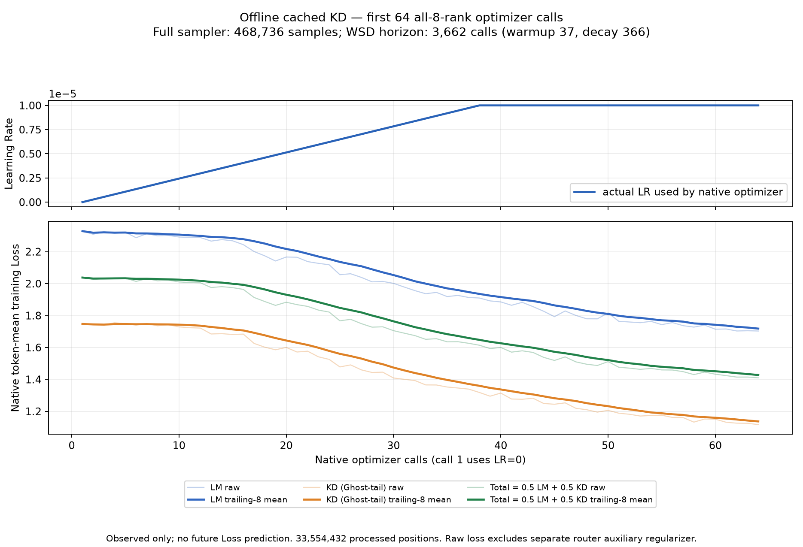

# Offline cached KD — original first 64 calls

- Experiment: **2026-10-18, the initial student generation `offline2b-prefixtrain-01`**.
- Scope: **native optimizer calls 1–64 only**. No continuation, restarted, filtered, or dynamic generation is added to these counters or curves.
- **Training is stopped at the user's request. Documentation did not restart it.**
- [한국어](../ko/MIDTRAIN_OFFLINE_KD_FIRST64_RESULTS.md) · [Computed summary JSON](../assets/offline-kd-first64/summary.json) · [64-call metric CSV](../assets/offline-kd-first64/metrics.csv)

## 1. Result

All eight ranks completed **64 optimizer calls**: **63 positive-LR learning updates and one initial zero-LR call**. Skipped and Nonfinite counts were zero; every reported Grad Norm was finite and positive. The run processed **33,554,432 positions** and **8,192 global samples**. Positions include the initial zero-LR call; they are not multiplied by the eight ranks again.

LM Loss, KD Loss, and Primary Total Loss decreased between the first and last eight-call windows. These are **observed training-loss statistics**, not evidence of validation/benchmark improvement or sustained full-prefix stability.

## 2. Learning Rate and Loss figure

- Top: the Learning Rate **actually used by that native optimizer call**, not its post-step scheduler value.
- Bottom: LM Loss, Ghost-tail KD Loss, and `Primary Total = 0.5 × LM + 0.5 × KD`.
- Faint lines are raw observations; solid lines are **trailing eight-call means** of the same observations.
- Call 1 used LR=0. With the configured 37-iteration warmup, **call 38 was the first call to use LR=1e-5**; call 64 also used LR=1e-5.
- Router auxiliary regularization is separate from the displayed primary scalar. No future Loss or unexecuted schedule segment is synthesized.
- The original PNG was copied unchanged into documentation assets. Both files have SHA256 `69ee1db30128699f551922042a88da556dcb58e32d81a11b5d796a3157af2ccb`. This verifies **figure identity**, not checkpoint payload integrity.

## 3. Recorded metrics

### First eight calls versus last eight calls

| Metric | Calls 1–8 mean | Calls 57–64 mean | Relative decrease |
|---|---:|---:|---:|
| LM Loss | 2.312244 | 1.718245 | 25.69% |
| KD Loss | 1.744951 | 1.137173 | 34.83% |
| Primary Total Loss | 2.028598 | 1.427709 | 29.62% |

Relative decrease is `(first-window mean − last-window mean) / first-window mean`. The windows contain different training batches; this is not a matched fixed-example before/after evaluation or a causal estimate of the benefit of KD.

### Raw endpoints

| Metric | Call 1 | Call 64 |
|---|---:|---:|
| LM Loss | 2.328561 | 1.703239 |
| KD Loss | 1.747200 | 1.117284 |
| Primary Total Loss | 2.037881 | 1.410262 |

- Grad Norm range: **0.231944–1.385862**. Native gradient clipping was configured at 1.0; the reported norm must not be interpreted as a post-clipping norm.
- Over the last eight calls, the mean of the **maximum rank callback duration for each call** was **9.730136 seconds/call**. This CUDA-synchronized callback timing does not include all model initialization, checkpoint saving, and end-to-end wall time. It is not a controlled online/offline KD or pretraining speed comparison.
- Raw reduced Loss values, LR, and Grad Norm were identical across all ranks for every reported call. Reduced values were not summed across eight ranks again.

## 4. Configuration and lineage

| Item | Recorded setting |
|---|---|
| Student initialization | Completed BASE19074, `checkpoints/exports/nemochat_baby_base_hf_bf16_02`; model-only warmstart with fresh optimizer/RNG/cursor |
| Teacher | `nvidia/NVIDIA-Nemotron-3.5-Super-VL-120B-A12B-Base-BF16` |
| Teacher revision | `4ba52e8ffa79e9693936c1a819ac89f551ceeef6` |
| Teacher usage | Existing frozen-teacher offline Top-32 cache; no teacher forward in the student execution |
| Framework | Native Megatron Bridge pretrain with the isolated Core-first cached-KD adapter, not a handwritten optimizer loop |
| Objective | LM plus native Ghost-tail KD, fixed alpha=0.5; not claimed equivalent to the online ModelOpt detached magnitude-balancer objective |
| Precision / topology | BF16 student, FP16 teacher cache; eight GPUs, TP1 / PP1 / CP1 / EP8, student DP8 |
| Sequence / batch | Sequence Length 4096; Global Batch Size 128; Micro Batch Size 1; 16 microbatches/rank/call |
| Source mixture | Code / Algorithmic / Formal / Replay = 67 / 10 / 3 / 20 |
| Seed | 43 |
| Original full source sampler budget | `[468736, 120, 8]` for train / validation / test |
| Full schedule | WSD horizon 3662, warmup 37, decay 366, LR 1e-5 / min LR 1e-6 |
| Available prefix at that time | Source iterations 0–1142; 1143 describes cache availability, not completed student learning in this report |
| Reported range | Source iterations 0–63, optimizer calls 1–64, before the later static/dynamic exclusion generations |

The run consumed a completed cache prefix while retaining the original full sampler and schedule. It was not a newly constructed 64-step sampler and did not complete the approximately 1.920B-position full target. Cache ID: `8e2ba57bb9e10d4b6b5ca2fe82a7e1969c285acb392afca9121cbda29e36bd4d`.

## 5. Alignment and checkpoint evidence

- Re-read `student-rank{0..7}-updates.jsonl` and verified exactly calls 1–64, LR, Loss, Grad Norm, and skipped status on each rank.
- Rechecked the first **1,024 microbatch digest rows per rank**, **8,192 rows total**, against the original teacher's matching source iteration/rank. Each recorded digest covers tokens, labels, loss masks, and position IDs. Digest-row counts and global-sample counts are distinct accounting units even though their totals coincide here with Micro Batch Size 1.
- The native synchronous-save transaction contains eight acknowledgements of the same `next_iteration=64`, `consumed_samples=8192`, and cache/sampler binding.
- Checkpoint location: [`results/midtraining/offline2b-prefixtrain-01/checkpoint/iter_0000064/`](../../results/midtraining/offline2b-prefixtrain-01/checkpoint/iter_0000064/).
- Native model, optimizer, and RNG saving is recorded. A later independent continuation restored step64 on all ranks and executed subsequent updates; **those updates are not in this report's figure**.
- **No model/optimizer checkpoint payload SHA or CRC audit was performed**, in accordance with `not_checked_explicit_user_waiver`. Do not confuse document/log/figure digests with checkpoint byte validation. Documentation did not reload the checkpoint or execute the model.

## 6. Limitations and stopped state

1. This report preserves initial training Loss and operational checkpoint evidence. It contains no matched validation comparison, benchmark result, generalization claim, or proof of online/offline objective parity.
2. Later continuation and restarted generations encountered separate cache read/SHA failures. The first64 observations do not establish whole-prefix integrity or long-run success. Later generations remain separate experiments.
3. Training is stopped by user instruction. The [intentional-stop receipt](../../results/midtraining/offline1920-parent-01/user-training-stop-20261018-1342.json) is retained. This report is not permission to restart.

## 7. Evidence and reproduction boundary

- [Original 64-call PNG](../../results/midtraining/offline2b-prefixtrain-01/lr-loss-first64.png) / [plot data JSON](../../results/midtraining/offline2b-prefixtrain-01/lr-loss-first64.json)
- [Original first64 proof](../../results/midtraining/offline2b-prefixtrain-01/first64-proof.json)
- [Run config](../../results/midtraining/offline2b-prefixtrain-01/run-config.json) / [segment plan](../../results/midtraining/offline2b-prefixtrain-01/segment-plan.json)
- [Checkpoint64 transaction](../../results/midtraining/offline2b-prefixtrain-01/checkpoint-step64-transaction.json)
- [Separate operational resume proof](../../results/midtraining/offline2b-prefixtrain-01/operational-resume-proof.json) — a historical snapshot, not current liveness
- Rank evidence: `results/midtraining/offline2b-prefixtrain-01/student-rank{0..7}-{updates,samples}.jsonl`
- Teacher input records: `results/midtraining/offline2b-production1920-01/teacher-rank{0..7}-samples.jsonl`
- The documentation [summary JSON](../assets/offline-kd-first64/summary.json) records rederived metrics and SHA256 identities of textual evidence and the figure. The [CSV](../assets/offline-kd-first64/metrics.csv) exports one row per call from global-reduced metrics after checking rank agreement.

Rerunning the existing renderer would update the original run's figure. This report therefore embeds an unchanged copy rather than redrawing the historical artifact. Verification covered logs, JSON, CSV, the figure, and relative links only; no GPU training was performed.
